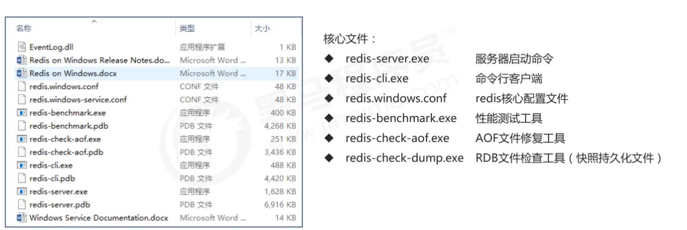

# Redis 概述

## 什么是 Redis

Redis 是一个开源的（BSD许可）的，内存中的（非关系型）数据结构存储系统，它可以用作数据库、缓存和消息中间件。

https://redis.ac.cn/docs/latest/

## Redis 安装

### Windows

https://github.com/redis-windows/redis-windows/releases



### Docker

https://redis.ac.cn/docs/latest/operate/oss_and_stack/install/install-stack/docker/

在 Docker 上运行 Redis 开源版

```bash
docker run -d --name myredis -p 6379:6379 redis:<version>
```

使用本地配置文件

```bash
docker run -v /myredis/conf:/usr/local/etc/redis \
--name myredis redis \
redis-server /usr/local/etc/redis/redis.conf
```

其中 /myredis/conf/ 是包含您的 redis.conf 文件的本地目录。

连接到 redis-cli

```bash
docker exec -it myredis redis-cli
```

如果您已在本地安装 redis-cli，则可以从您的终端中运行它

```bash
redis-cli -h <docker_host_ip> -p 6379
```
