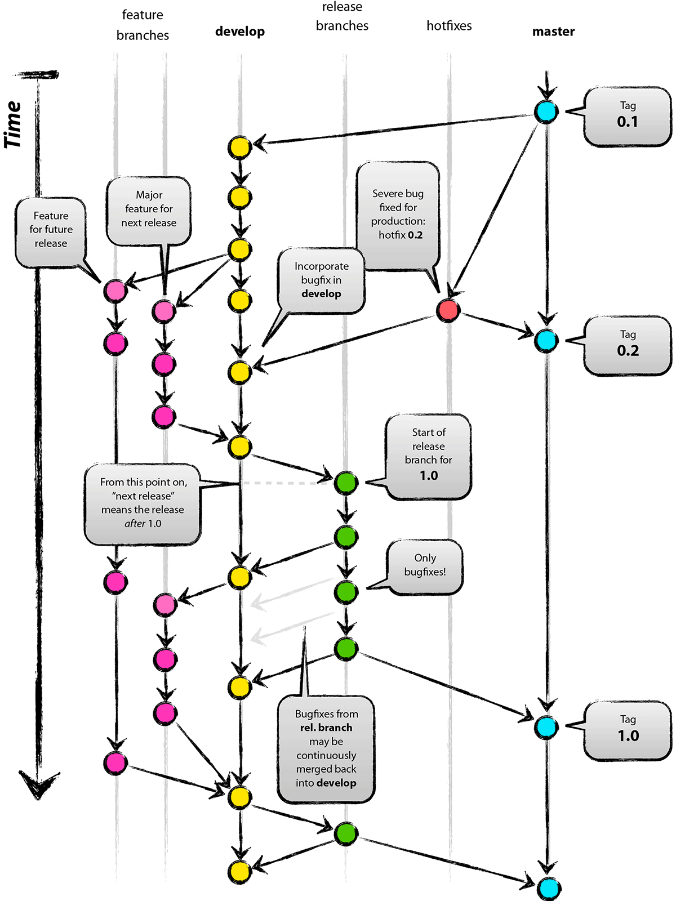
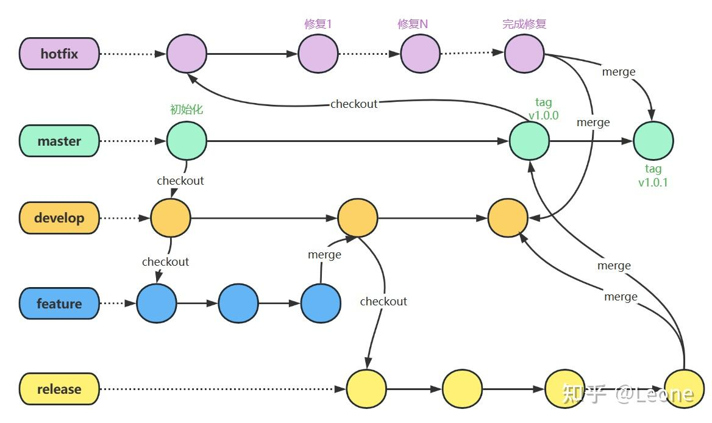
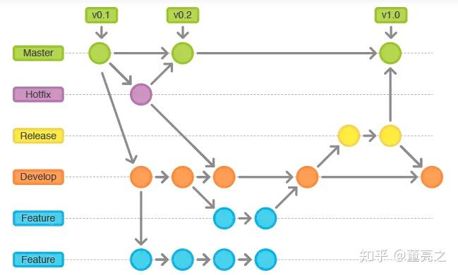

# 一、什么是 Git Flow

Git Flow 是由 Vincent Driessen 在 2010 年提出的一种高度结构化的 Git 分支管理策略，适用于需要频繁发布、有明确版本控制需求的软件项目。其核心是基于不同用途的分支来管理项目开发流程，主要包括两个主分支和三个辅助分支。

与简单的 Git 使用方式相比，Git Flow 通过定义明确的**分支类型** 和**流转规则**，为团队协作提供了一套标准化的流程规范，帮助中大型项目统一开发节奏、降低管理混乱。

# 分支类型

## 2.1 永久分支

### main（或 master）分支

存放生产环境稳定版本的代码，任何时候从这个分支获取的代码都应该是可直接部署的稳定版本

只能通过 release 或 hotfix 分支合并进入，不允许直接提交代码

每次合并都应打上版本标签（如 v1.0.0），代表一个正式发布版本

### develop 分支

日常开发的主分支，集成所有已完成的功能

新功能必须基于 develop 分支创建 feature 分支

所有 release 和 hotfix 分支最终都要合并回 develop 分支

该分支存放最新的开发进度代码

## 2.2 临时分支

### feature/ 分支（功能分支）

用途：开发单个新功能

创建来源：从 develop 分支切出

合并目标：完成后合并回 develop 分支

生命周期：临时分支，合并后删除

### release/ 分支（发布分支）

用途：为新版本发布做准备，进行测试和小型 bug 修复，不新增功能代码

创建来源：从 develop 分支切出

合并目标：完成后同时合并到 master 和 develop 分支

生命周期：临时分支，版本发布后删除

### hotfix/ 分支（热修复分支）

用途：紧急修复生产环境中的 bug，优先级高于 feature 分支

创建来源：从 master 分支切出

合并目标：修复完成后同时合并到 master 和 develop 分支

生命周期：临时分支，修复完成后删除

# 分支流转规则

## 分支流转图例

### 图例 1

### 图例 2

### 图例 3

